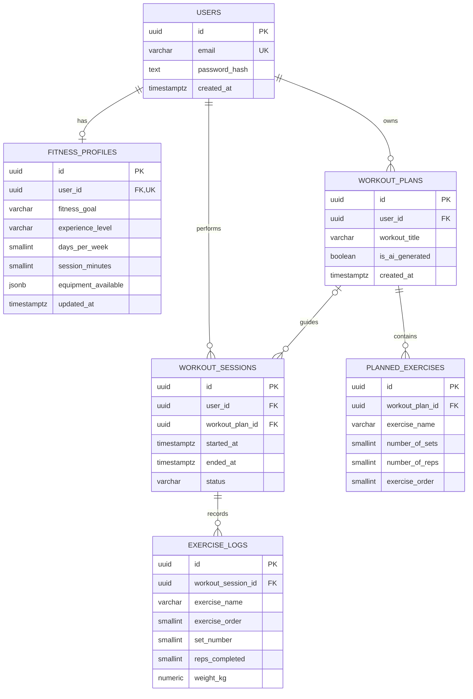

# AI Fitness Coach — Database Design

**Status:** Proposed MVP schema (design only; not yet migrated)  
**Database:** PostgreSQL  
**Backend:** FastAPI + SQLAlchemy + Alembic

## 1. Overview

AI Fitness Coach stores accounts, individual fitness preferences, generated workout plans, completed workout sessions, and individual set results. PostgreSQL is the source of truth for this persistent data.

The MVP uses six tables:

1. `users` — accounts and authentication credentials.
2. `fitness_profiles` — one fitness profile per user.
3. `workout_plans` — planned routines owned by users.
4. `planned_exercises` — prescribed exercises within a plan.
5. `workout_sessions` — actual workout attempts, optionally based on a plan.
6. `exercise_logs` — one record per performed exercise set.

**Scope:** This document describes the intended relational design. The SQL is illustrative and will be implemented with SQLAlchemy models and Alembic migrations. It does not yet configure a running database.

## 2. Entity–relationship diagram



> Relationship cardinalities describe intended application behavior. A newly created plan or session may temporarily have zero child rows; completion requirements are enforced by application logic where appropriate.

## 3. Table schemas

### 3.1 `users`

Stores an account's identity and password hash. Never store plaintext passwords.

| Column | PostgreSQL type | Constraints / default | Purpose |
|---|---|---|---|
| `id` | `UUID` | Primary key; `DEFAULT gen_random_uuid()` | Account identifier |
| `email` | `VARCHAR(255)` | `NOT NULL`, `UNIQUE` | Email-based login |
| `password_hash` | `TEXT` | `NOT NULL` | Secure, salted password hash |
| `created_at` | `TIMESTAMPTZ` | `NOT NULL`, `DEFAULT CURRENT_TIMESTAMP` | Account creation time |

**Notes:** Normalize email input consistently before storage and lookup. Decide on case-insensitive email uniqueness during implementation (for example, a unique index on `lower(email)`), rather than assuming a standard `UNIQUE` constraint is case-insensitive. Use a vetted password-hashing library with Argon2id or a similarly appropriate algorithm; never implement password hashing manually.

### 3.2 `fitness_profiles`

Stores one set of workout preferences per user.

| Column | PostgreSQL type | Constraints / default | Purpose |
|---|---|---|---|
| `id` | `UUID` | Primary key; generated UUID | Profile identifier |
| `user_id` | `UUID` | `NOT NULL`, `UNIQUE`, FK → `users.id` | Profile owner; ensures at most one profile per user |
| `fitness_goal` | `VARCHAR(50)` | `NOT NULL` | Goal, e.g. `build_muscle` |
| `experience_level` | `VARCHAR(30)` | `NOT NULL` | e.g. `beginner`, `intermediate`, `advanced` |
| `days_per_week` | `SMALLINT` | `NOT NULL`, `CHECK (days_per_week BETWEEN 1 AND 7)` | Weekly training frequency |
| `session_minutes` | `SMALLINT` | `NOT NULL`, `CHECK (session_minutes > 0)` | Target session duration |
| `equipment_available` | `JSONB` | `NOT NULL`, `DEFAULT '[]'::jsonb`, optional JSON-array check | List of accessible equipment |
| `updated_at` | `TIMESTAMPTZ` | `NOT NULL`, initial default current time | Last profile update |

**Notes:** Validate allowed goals and experience levels using Pydantic and optionally PostgreSQL `CHECK` constraints. `updated_at` must be explicitly refreshed on updates by the application or a database mechanism; its insert default alone does not do this. PostgreSQL's `jsonb_typeof(equipment_available) = 'array'` can constrain the JSON shape.

### 3.3 `workout_plans`

Stores workout prescriptions, regardless of whether they were created by AI or manually.

| Column | PostgreSQL type | Constraints / default | Purpose |
|---|---|---|---|
| `id` | `UUID` | Primary key; generated UUID | Plan identifier |
| `user_id` | `UUID` | `NOT NULL`, FK → `users.id` | Plan owner |
| `workout_title` | `VARCHAR(255)` | `NOT NULL` | Human-readable title |
| `is_ai_generated` | `BOOLEAN` | `NOT NULL`, `DEFAULT FALSE` | Origin of plan |
| `created_at` | `TIMESTAMPTZ` | `NOT NULL`, `DEFAULT CURRENT_TIMESTAMP` | Creation time |

**Notes:** `user_id` is deliberately **not unique**: each user may own multiple plans. Consider a future `source` enum or text field if plans may be imported or created in additional ways.

### 3.4 `planned_exercises`

Stores prescribed exercises belonging to a single workout plan.

| Column | PostgreSQL type | Constraints / default | Purpose |
|---|---|---|---|
| `id` | `UUID` | Primary key; generated UUID | Planned-exercise identifier |
| `workout_plan_id` | `UUID` | `NOT NULL`, FK → `workout_plans.id` | Parent plan |
| `exercise_name` | `VARCHAR(255)` | `NOT NULL` | Exercise name |
| `number_of_sets` | `SMALLINT` | `NOT NULL`, `CHECK (number_of_sets > 0)` | Planned sets |
| `number_of_reps` | `SMALLINT` | `NOT NULL`, `CHECK (number_of_reps > 0)` | Planned reps per set |
| `exercise_order` | `SMALLINT` | `NOT NULL`, `CHECK (exercise_order > 0)` | Position within plan |

**Composite constraint:** `UNIQUE (workout_plan_id, exercise_order)`. Positions must be unique **within a plan**, not across all plans. This does not require positions to be consecutive; application logic handles ordering/reordering.

**MVP limitation:** The design handles repetition-based exercises. Time-based exercises, warmups, rest times, and per-set prescriptions can be introduced later.

### 3.5 `workout_sessions`

Represents an actual workout attempt, with or without a preexisting workout plan.

| Column | PostgreSQL type | Constraints / default | Purpose |
|---|---|---|---|
| `id` | `UUID` | Primary key; generated UUID | Session identifier |
| `user_id` | `UUID` | `NOT NULL`, FK → `users.id` | User who performed it |
| `workout_plan_id` | `UUID` | Nullable, FK → `workout_plans.id`, `ON DELETE SET NULL` | Optional originating plan |
| `started_at` | `TIMESTAMPTZ` | `NOT NULL`, `DEFAULT CURRENT_TIMESTAMP` | Start time |
| `ended_at` | `TIMESTAMPTZ` | Nullable | End time, if finished or abandoned |
| `status` | `VARCHAR(20)` | `NOT NULL`, `DEFAULT 'in_progress'` with allowed-value check | Session state |

**Allowed statuses:** `in_progress`, `completed`, `abandoned`.

**Checks:**

```sql
CHECK (status IN ('in_progress', 'completed', 'abandoned')),
CHECK (ended_at IS NULL OR ended_at >= started_at),
CHECK (
    (status = 'in_progress' AND ended_at IS NULL)
    OR (status IN ('completed', 'abandoned') AND ended_at IS NOT NULL)
)
```

**Notes:** A session can be created with no end time. When it completes or is abandoned, the backend must set `ended_at` and update `status` together. Additional API logic will enforce allowed state transitions.

When the originating plan is deleted, `workout_plan_id` becomes `NULL` and the historical session remains. When a plan changes, existing exercise logs continue to represent actual performed results. Preserving the *original prescription* exactly would require immutable plan versions or snapshots in a future iteration.

### 3.6 `exercise_logs`

Stores **one record per performed set**. This captures differences between prescribed and actual performance.

| Column | PostgreSQL type | Constraints / default | Purpose |
|---|---|---|---|
| `id` | `UUID` | Primary key; generated UUID | Set-log identifier |
| `workout_session_id` | `UUID` | `NOT NULL`, FK → `workout_sessions.id` | Parent session |
| `exercise_name` | `VARCHAR(255)` | `NOT NULL` | Performed exercise |
| `exercise_order` | `SMALLINT` | `NOT NULL`, `CHECK (exercise_order > 0)` | Exercise position in session |
| `set_number` | `SMALLINT` | `NOT NULL`, `CHECK (set_number > 0)` | Set position for that exercise |
| `reps_completed` | `SMALLINT` | `NOT NULL`, `CHECK (reps_completed >= 0)` | Actual repetitions; zero allowed for failed attempts |
| `weight_kg` | `NUMERIC(6,2)` | Nullable, `CHECK (weight_kg >= 0)` | External load, if applicable |

**Composite constraint:** `UNIQUE (workout_session_id, exercise_order, set_number)`. This rejects duplicate set positions within a session and exercise, while allowing different exercises to each have a set 1.

**Zero versus NULL:** `reps_completed = 0` can represent an attempted set with no successful repetitions. `weight_kg = 0` explicitly means zero external load; `NULL` means the load was not recorded or does not apply. `NUMERIC(6,2)` avoids binary floating-point surprises for decimal weights.

**Notes:** `exercise_name` is repeated across individual set logs for a simple MVP. A future `session_exercises` parent table could centralize exercise names and order, making per-exercise metadata easier to maintain.

## 4. Relationship summary

| Parent | Child | Cardinality | Rule |
|---|---|---|---|
| `users` | `fitness_profiles` | One to zero-or-one | `fitness_profiles.user_id` is unique |
| `users` | `workout_plans` | One to many | Each plan has one owner |
| `workout_plans` | `planned_exercises` | One to many | Each planned exercise belongs to one plan |
| `users` | `workout_sessions` | One to many | Each session has one owner |
| `workout_plans` | `workout_sessions` | One to many, optional from session | Plan may be absent or deleted |
| `workout_sessions` | `exercise_logs` | One to many | Each log is one performed set |

## 5. Referential integrity, ownership, and deletion

- **Ownership:** Every query that accesses a user-owned plan, profile, or session must filter or authorize against the authenticated user's ID. UUIDs are identifiers, **not** authorization controls.
- **Plan/session consistency:** If `workout_sessions.workout_plan_id` is provided, the referenced plan must belong to the same user as the session. A simple foreign key on plan ID does **not** prove same-user ownership; validate this in API/service code (and consider stronger database enforcement if needed).
- **Delete a workout plan:** Preserve completed sessions using `ON DELETE SET NULL` on `workout_sessions.workout_plan_id`. Define intentional deletion of the plan's `planned_exercises` (typically `ON DELETE CASCADE`) when implementing migrations.
- **Delete a session:** A deliberately deleted session should remove its child `exercise_logs` (typically `ON DELETE CASCADE`). Avoid accidentally deleting history through unrelated plan changes.
- **Delete a user:** Account deletion should be an explicit, authorized workflow with a documented retention policy. Decide whether to cascade or explicitly delete profiles, plans, sessions, and their children; do not rely on implicit defaults.
- **Updates:** Editing a workout plan must not rewrite historical exercise logs. Full prescription history requires a versioned-plan/snapshot feature later.
- **Indexes:** Uniqueness creates indexes for unique keys. Consider additional indexes on `workout_plans.user_id`, `workout_sessions(user_id, started_at)`, and child foreign keys as usage grows.

## 6. Design decisions

### Why use UUID primary keys?

UUIDs provide unique identifiers without depending on sequential integer assignment across environments. They work well for API resource IDs. UUIDs do not themselves provide privacy or access control.

### Why separate workout plans from workout sessions?

A plan represents the **intended workout**, while a session represents an **actual attempt** at a particular time. A user may perform the same plan repeatedly, change their results, or do an unplanned session. Storing sessions separately preserves that history.

### Why do exercise logs represent individual sets?

Set-level records preserve actual reps and weight for each set, which supports progress analysis and comparison with AI recommendations. For example, sets of 10, 9, and 8 repetitions retain more information than a single summary of 3 sets.

### Why use composite unique constraints?

An order or set number is unique only **within its parent context**. `UNIQUE (workout_plan_id, exercise_order)` protects plan ordering, and `UNIQUE (workout_session_id, exercise_order, set_number)` prevents duplicate performed-set positions.

### How do we preserve workout history when plans are deleted?

A session's `workout_plan_id` is nullable and uses `ON DELETE SET NULL`, so deleting a plan removes the association without deleting the session or its logged performance. Exact historical plan prescriptions would need plan versions or snapshots.

### How do we prevent users from accessing another user's data?

FastAPI endpoints will authenticate the caller and authorize each requested resource by its owner. Database foreign keys ensure relationships exist but do not replace owner-based authorization. Tests should verify that one authenticated user cannot read or modify another user's resources.

## 7. Validation and future enhancements

- Validate allowed `fitness_goal`, `experience_level`, and `status` values consistently in Pydantic; add appropriate database constraints where useful.
- Normalize and enforce uniqueness of account emails in a consistent case-insensitive manner.
- Design secure authentication (password hashing, sessions/tokens, authorization tests) separately from schema creation.
- Consider workout plan versioning to preserve old AI prescriptions.
- Extend exercises for durations, distances, tempo, rest periods, and workout notes.
- Consider dedicated `session_exercises` and `exercise_catalog` tables once the MVP requires richer exercise metadata.
- Use consistent UTC-aware timestamp handling, converting to local time for display.
- Add migration-backed database tests to verify critical constraints and deletion behavior.

## 8. Implementation plan

1. Provision a local PostgreSQL development database; keep credentials out of Git.
2. Configure FastAPI's database connection using environment-based settings.
3. Implement SQLAlchemy 2.x models reflecting the approved constraints and relationships.
4. Initialize Alembic and generate/review the initial migration.
5. Run migrations and inspect PostgreSQL tables and indexes.
6. Add database tests for foreign keys, uniqueness, statuses, timestamps, and owner isolation.
7. Build authenticated endpoints for creating and retrieving fitness profiles before implementing workout generation and logging.

**Acceptance criteria for the design phase:** All six tables are documented, relationships are consistent, constraints are explicit, deletion and ownership behavior is explained, and unresolved decisions are identified before migrations are written.
